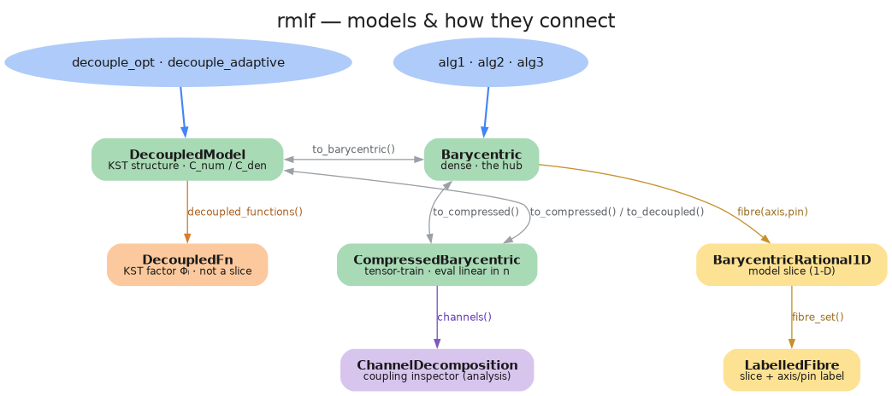

# rmlf — multivariate Loewner Framework

Build an `n`-variable **rational interpolant** of an unknown function `f(x₁, …, xₙ)`
— from a Rust closure or a precomputed data tensor — in barycentric form, with the
curse of dimensionality tamed so construction, storage, and evaluation all stay
tractable as `n` grows.

rmlf is a Rust implementation of the multivariate Loewner Framework of A. C.
Antoulas, I. V. Gosea & C. Poussot-Vassal, porting and building on their work and
the original MATLAB package [`cpoussot/mLF`](https://github.com/cpoussot/mLF). It
adds measured improvements over the reference (per-axis adaptive sampling,
non-rational stabilization). See [References & attribution](#references--attribution).

## Quick start

```rust
use rmlf::prelude::*;

// Any function of n inputs → one output. (Pólya–Szegő, n = 3.)
let f = |x: &[f64]| x[0] * x[1] + x[0] * x[2] + x[1] * x[2];

// Support points on per-axis bounds, then fit.
let pts = Points::alternating(&[(-1.0, 1.0); 3], &[4, 4, 4]).unwrap();
let (model, _info) = alg1(&f, &pts, &Alg1Options::default()).unwrap();

let y = model.eval(&[0.1, -0.3, 0.5]);   // barycentric evaluation, off-grid
```

For rational/polynomial targets the fit is **exact to machine precision**; the
interpolant fills the gaps between grid points and reconstructs isolated
singularities from the surrounding data.

## Complex input and output

The numerical core supports both `f64` and `num_complex::Complex64`, with
`f64` remaining the default. Algorithms 1 and 2, order detection, point
selection, tensors and barycentric evaluation share monomorphized code: real
fits still use native real arithmetic, not complex arithmetic or dynamic dispatch.

```rust
use rmlf::prelude::*;

let f = |z: &[Complex64]| Complex64::new(1.0, 2.0) / (z[0] + 3.0);
let pts = Points::chebyshev_segments(
    &[(Complex64::new(-1.0, 0.2), Complex64::new(1.0, 0.8))], &[10],
).unwrap();
let (model, _) = alg1(&f, &pts, &Alg1Options::default()).unwrap();
let y = model.eval(&[Complex64::new(0.3, -0.4)]);
```

Use `Points::new` for arbitrary complex nodes (including circles or conjugate
pairs). Mixed real/complex axes use complex coordinates with zero imaginary
parts on the real axes. `real_points.to_complex()` embeds an existing grid;
`real_model.to_complex()` evaluates a fitted real rational at complex arguments.
Precomputed complex samples work with `Tensor<Complex64>` and
`alg1_from_tensor` / `alg2_from_tensor` in the same `column ++ row` ordering.
Tolerances, singular values and error diagnostics remain real-valued; residuals
use complex magnitudes, and null-vector normalization preserves phase.

Recursive, full and automatic coefficient construction all support complex
data. Algorithm 2's scan modes also work; its `compress` option is ignored for
complex models, which use dense evaluation. Grid refinement (`alg3`), KST
decoupling, TT/TT-cross compression, AAA/Lawson coefficient fitting, and the
fibre/contribution analysis addons remain real-only. Existing real APIs retain
those capabilities. Closure fits retain the legacy non-finite continuation fill;
data-tensor fits reject non-finite samples. Avoid sampling poles where possible.

## Choosing an entry point

| I want… | Use |
|---------|-----|
| a one-shot fit on a fixed grid | [`alg1`] / `alg1_from_tensor` (data) |
| adaptive support selection (greedy) | [`alg2`] |
| adaptive grid **resolution** (refinement) | [`alg3`] |
| an exact, SVD-free **decoupled** rational (KST) | [`decouple_opt`] / `decouple_adaptive` |
| a 1-D near-minimax fit (AAA + Lawson) | `aaa` |
| exact arithmetic over ℚ / 𝔽_p | the `exact` module |

All paths return an evaluable model (`Barycentric` / `DecoupledModel`).
`CompressedBarycentric` keeps a high-`n` model in tensor-train form (eval linear
in `n`).

## What makes it scale

- **Recursive null space** — the headline of the framework. Instead of one
  monolithic `O(K³)` Loewner SVD (exponential in `n`), the solve becomes a sum of
  tiny per-axis 1-D SVDs. The huge n-D Loewner matrix is never formed.
- **KST variable decoupling** — for a rational target the barycentric weights are
  *explicit evaluations*, no SVD at all (`decouple_opt`). The model is a
  superposition of single-variable rationals — a Kolmogorov-Superposition-Theorem
  analogue for rational functions.
- **Tensor-train storage & eval** — `CompressedBarycentric` stores the coefficient
  tensors in TT form, so evaluation is `O(r²·Σ kₗ)` (linear in `n`) instead of the
  dense `O(∏ kₗ)`.

## Models & how they connect

The fitters return one of three interchangeable model types (all implement the
`Model` trait, all convert between each other exactly via `.into()`). The 1-D views
— slices (`fibre`), the KST factors (`decoupled_functions`), the per-axis
contributions (`Contributions`), and the coupling inspector — hang off them. See
[`docs/MODELS.md`](docs/MODELS.md) for the details.

### Per-axis contribution analysis

To analyse one variable at a time, collapse the `n`-D model to **one 1-D
barycentric rational per axis** (the opposite of a `fibre`: the other axes are
*summarised*, not pinned). Three distinct angles, all returning a usable
`BarycentricRational1D` for the classic 1-D toolkit:

- `rank_contracted_factor(axis)` — the axis's role *within the coupling* (contract
  the other axes' TT cores against their canonical boundary; exact, TT-cheap);
- `marginal(axis)` — the axis's *average* behaviour `E[g|x_l]`;
- `sobol_main_effect(axis)` — the same curve plus a variance-based *importance*
  index.

Same workflow as fibres: a manual axis pick, or the automatic full set
`contribution_set(kind)` carrying per-axis degree, representation rank, and an
importance ranking.



## Per-axis adaptive sampling

The framework decomposes the `n`-D problem into independent **1-D** problems, so
each axis carries its own degree and deserves its own number of points. A single
uniform point count is the wrong shape: it under-resolves high-degree axes, or
blows the grid up when raised. `decouple_adaptive` (and `decouple_opt` with
`Sampling::Adaptive`) grow **only the under-resolved axes**, keeping mixed-degree
high-`n` targets tractable.

```rust
use rmlf::prelude::*;

// A 6-variable rational with different degrees per axis — recovered exactly.
let f = |x: &[f64]| (x[0] + x[2]) / (x[0].powi(4) + x[1]*x[2] + x[3].powi(3) + x[4]*x[4] + x[5]);
let (model, info) = decouple_adaptive(&f, &[(0.1, 1.0); 6], 6, 16).unwrap();
// info.degree == [4, 1, 1, 3, 2, 1] — recovered exactly (~2e-12), grid stays small
let _ = model.eval(&[0.5; 6]);
```

Sampling is configurable per axis ([`AxisSampling`]): `Linspace`, `Chebyshev`,
`Logspace`, `Integers` (only the integers in a range — for discrete inputs), or
`Reference` (the original MATLAB linspace + half-step rows, which samples slightly
outside the bounds). Each axis's **column and row sets are chosen independently**
(`AxisSpec`): one rule alternating-split, two different rules/counts per side, or a
custom closure of arbitrary points.

## Exact arithmetic (ℚ and 𝔽_p)

The same construction runs over exact fields with **no SVD** (the decoupling needs
none), giving bit-exact rational reconstruction and order detection as a *theorem*
rather than a tolerance:

```rust
use rmlf::exact::rational::fit_poly;
let m = fit_poly(|x| &x[0] * &x[1] + &x[0] * &x[2] + &x[1] * &x[2], &[1, 1, 1]).unwrap();
assert_eq!(m.eval_int(&[5, 7, 11]).unwrap(), 5*7 + 5*11 + 7*11);   // exact
```

## Input requirements

The framework needs a **dense Cartesian grid** of samples (no scattered/gappy
input) and **disjoint** column/row support sets per axis (the Loewner construction
divides by node gaps — coincident nodes are undefined). The point builders
(`Points::alternating`, `chebyshev`, `sampled`) produce disjoint sets for you.

## Examples & benchmarks

The function catalog is always available. Cargo auto-discovers the example
runners; no feature flags are needed.

`src/examples.rs` contains the MATLAB reference function catalog (rational,
polynomial, irrational; including the Borehole `n=8` function). `examples/` sweeps it
through each algorithm — see `decouple_sweep`, `catalog_sweep`, `alg2_scale`,
`alg3_refine`, `tt_demo`. The standalone `loewner_bench` example charts
recursion, order detection, end-to-end fitting and evaluation scaling using
wall-clock averages; it runs like the other examples, with no benchmark harness.

`catalog_sweep_full` runs only Alg1 with `CoefficientMethod::Full`, using the
same table layout and 4000 deterministic off-grid queries as `catalog_sweep`.
Alg2/Alg3 are marked `SKIP`. Its configurable per-case RAM estimate defaults to
1024 MiB: it checks sampling/order-detection storage before sampling, then uses
the detected orders to check the reduced full matrix, singular vectors and Faer
SVD workspace before fitting. Estimates include 2x headroom plus 16 MiB; this is
not an OS-enforced RSS cap or a time limit. Budget and skip reasons go to stderr
so stdout remains a result table. A single CAS prints just its row; omit it (or
use `all`) for the catalog and header. An optional second positional argument
overrides `nip`, just as in the standard sweep's single-case mode.

`rmlf::examples::complex` in that same catalog contains **all eleven** commented
`domain = Complex` cases (IDs 11–20 and 30), plus the active mixed-domain case 59.
The namespace distinguishes their IDs from the overlapping real catalog.
`complex_catalog` runs every case: all-axis and coupled sections for the
11–30-variable formulas, and a full 2-D fit for case 59. Sections avoid enormous
Cartesian tensors; they are not full high-dimensional fits. Original formulas
are independently checked against saved Octave values; regenerate them with
`octave-cli --no-init-file --quiet --no-history tests/fixtures/complex_reference.m`.
The sweep uses the same error/timing table as `catalog_sweep`, with complex
magnitudes and `SKIP` for real-only `alg3`. Its saved output is in
[`docs/complex_catalog_results.txt`](docs/complex_catalog_results.txt).

```sh
cargo run --release --example decouple_sweep
cargo run --release --example complex_catalog
cargo run --release --example loewner_bench fit 100
cargo run --release --example catalog_sweep_full -- --ram-mib 512
cargo run --release --example catalog_sweep_full -- 36 8 --ram-mib 256
```

## API layout

- **`rmlf::prelude::*`** — the everyday imports (the `alg*`/`decouple*` fitters,
  `Points`, model types, options).
- **module API** — `order`, `select`, `eval`, `tensor`, `tt`, `ttcross` for custom
  pipelines.
- **`rmlf::internals`** — the low-level recursive null-space solver and 1-D Loewner
  builders (including the monolithic multivariate reference builder). You almost
  never need these; call `alg1`/`decouple_opt`, not
  `loewner_null_rec`.

Algorithms 1 and 2 select their coefficient construction independently of the
greedy candidate scan:

```rust
use rmlf::{Alg2Options, CoefficientMethod};

let opt = Alg2Options {
    method: CoefficientMethod::Full,
    ..Alg2Options::default()
};
```

`Recursive` remains the scalable default; `Full` forms one dense multivariate
Loewner matrix, and `Auto` uses it only below conservative matrix/SVD bounds.
Algorithm 3 inherits the setting through `Alg3Options::inner`. This
`CoefficientMethod::Full` is separate from `Candidates::Full`, which controls
Algorithm 2's residual-grid scan.

## Validation

The construction is validated against the MATLAB reference (`octave-cli`):
`recurse` and `alg2` reproduce the reference's coefficient vectors to ~`1e-12`, and
rational/polynomial targets recover to machine precision.

## References & attribution

This crate is a Rust port of, and builds directly on, the multivariate Loewner
Framework developed by **A. C. Antoulas** (Rice University), **I. V. Gosea** (Max
Planck Institute for Dynamics of Complex Technical Systems, Magdeburg), and
**C. Poussot-Vassal** (ONERA, Toulouse). All credit for the underlying method is
theirs; this project provides an independent Rust implementation with permission
and encouragement from the authors.

The original MATLAB reference package: **[`cpoussot/mLF`](https://github.com/cpoussot/mLF)**
(C. Poussot-Vassal). rmlf's algorithms are validated against it.

Papers:

1. A. C. Antoulas, I. V. Gosea, C. Poussot-Vassal,
   *On the Loewner framework, the Kolmogorov superposition theorem, and the curse
   of dimensionality.* arXiv:[2405.00495](https://arxiv.org/abs/2405.00495) (2025).
   — the multivariate framework, recursive null space, and the KST connection.
2. A. C. Antoulas, I. V. Gosea, C. Poussot-Vassal,
   *Variable decoupling and the Kolmogorov Superposition Theorem for rational
   functions.* arXiv:[2605.07246](https://arxiv.org/abs/2605.07246) (2026).
   — the by-inspection, SVD-free rational decoupling (`decouple_opt`).
3. *Tensor-based multivariate function approximation: methods benchmarking and
   comparison.* arXiv:[2506.04791](https://arxiv.org/abs/2506.04791).
   — the cross-method benchmark suite rmlf's example catalog is measured against.

If you use rmlf in academic work, please cite the papers above.

## License

TBD.

[`alg1`]: https://docs.rs/rmlf/latest/rmlf/fn.alg1.html
[`alg2`]: https://docs.rs/rmlf/latest/rmlf/fn.alg2.html
[`alg3`]: https://docs.rs/rmlf/latest/rmlf/fn.alg3.html
[`decouple_opt`]: https://docs.rs/rmlf/latest/rmlf/fn.decouple_opt.html
[`AxisSampling`]: https://docs.rs/rmlf/latest/rmlf/enum.AxisSampling.html
